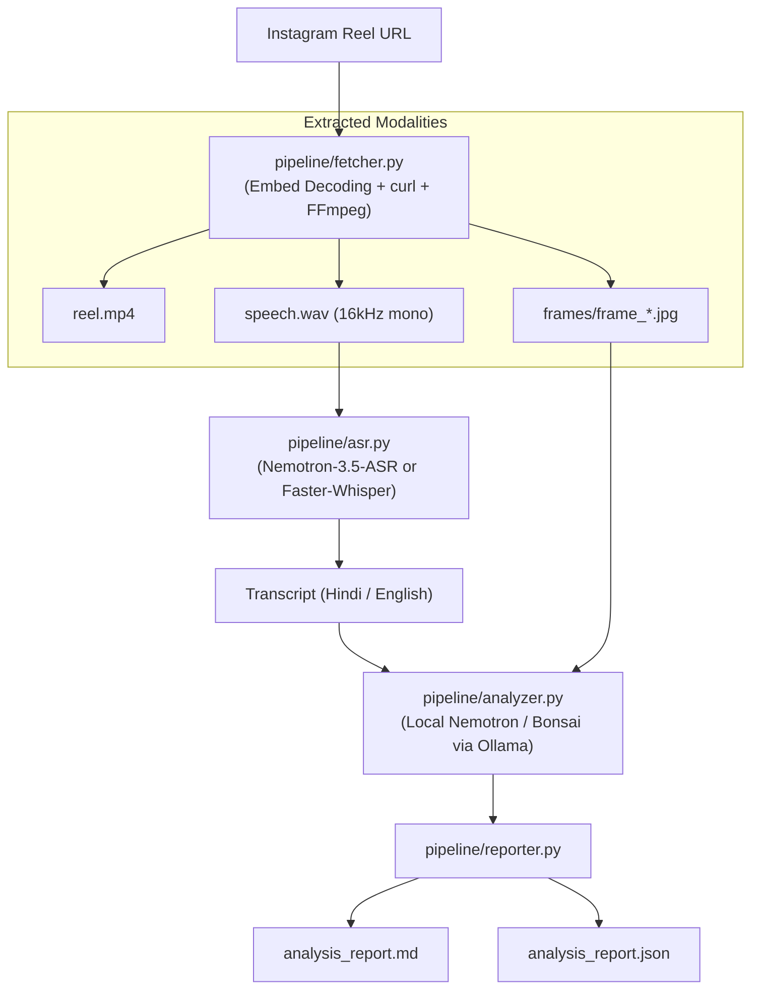

# 📱 Open-Source Instagram Reel & Video Analyser

A **100% local, privacy-first, open-source pipeline** to fetch, transcribe, and analyze Instagram Reels and videos using state-of-the-art open models on Apple Silicon.

---

## 🌟 Key Features

* **No Login Walls**: Bypasses Instagram's aggressive login blockers and rate limits via public embed payload decoding.
* **Direct High-Resolution Video Download**: Extracts raw `.mp4` video files directly from Meta's Content Delivery Network (CDN).
* **Multi-Modal Media Splitting (FFmpeg)**:
  * Generates clean 16kHz mono `speech.wav` optimized for ASR engines.
  * Extracts keyframe screenshots every $N$ seconds for visual analysis.
* **Dual Open-Source ASR (Speech-to-Text) Engines**:
  1. **NVIDIA Nemotron 3.5 ASR (`nvidia/nemotron-3.5-asr-streaming-0.6b`)**:
     * FastConformer-RNNT running directly on Apple Silicon Metal via **`mlx-audio`**.
     * High-fidelity native Devanagari Hindi and multilingual transcription.
  2. **Faster-Whisper (`faster-whisper`)**:
     * CTranslate2 `int8` CPU quantization.
     * Lightning fast (~$22\times$ faster than real-time; 5 seconds for a 2-minute reel).
* **Local Multimodal Reasoning (Ollama)**:
  * Uses **`nemotron-3.5-bolt:e4b-mxfp8`** or **`bonsai-2:latest`** running locally via Ollama.
  * Analyzes the opening hook, visual slide diagrams, and spoken transcript.
  * Produces an executive summary, system architecture explanation, and engineering critique.
* **Automated Publication-Grade Reports**:
  * Saves structured machine-readable JSON (`analysis_report.json`).
  * Generates formatted, human-readable Markdown (`analysis_report.md`).

---

## 🚀 Quick Start

### 1. Requirements & Prerequisites

* macOS with Apple Silicon (M1/M2/M3/M4)
* [Ollama](https://ollama.com/) running locally:
  ```bash
  ollama run nemotron-3.5-bolt:e4b-mxfp8
  ```

### 2. Environment Setup

```bash
# Ensure Python 3.11 virtual environment is active
source .venv311/bin/activate
```

---

## 💻 CLI Usage

### Basic Run (Fastest — Faster-Whisper + Local Nemotron)
```bash
python main.py "https://www.instagram.com/p/De9SJQIg9Kv/" --asr whisper
```

### High-Fidelity Run (NVIDIA Nemotron ASR + Local Nemotron LLM)
```bash
python main.py "https://www.instagram.com/p/De9SJQIg9Kv/" --asr nemotron
```

### Using Bonsai Reasoning Model
```bash
python main.py "https://www.instagram.com/p/De9SJQIg9Kv/" --asr whisper --llm "bonsai-2:latest"
```

### Customizing Keyframe Interval & Output Directory
```bash
python main.py "https://www.instagram.com/p/De9SJQIg9Kv/" \
  --output-dir ./runs/my_analysis \
  --interval 3 \
  --asr nemotron
```

---

## 📂 Output Artifacts

Each analysis run generates:
```
output/
├── reel.mp4                  # Full original video (720x1280 @ 30fps)
├── speech.wav                # 16kHz mono audio track for ASR
├── audio.mp3                 # Compressed audio preview
├── frames/                   # Extracted keyframe screenshots
│   ├── frame_001.jpg         # Opening title card / hook frame
│   ├── frame_002.jpg
│   └── ...
├── metadata.json             # Post metrics (creator, followers, duration, comments)
├── analysis_report.json      # Complete machine-readable data & transcripts
└── analysis_report.md        # Comprehensive executive & technical report
```

---

## 🏗️ Architecture



---

## 🔒 Privacy & Open-Source Guarantee

Every component in this pipeline executes **locally on your machine**. No audio, video, frames, or text transcripts are sent to third-party cloud APIs.
