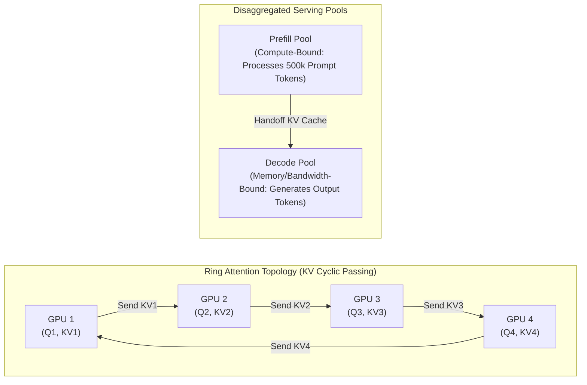

# Video Analysis Report: 48 LPA GenAI Systems Interview Reel

| Attribute | Details |
| :--- | :--- |
| **Platform** | Instagram Reel |
| **URL** | [https://www.instagram.com/p/De9SJQIg9Kv/](https://www.instagram.com/p/De9SJQIg9Kv/) |
| **Creator** | [@glueinfo6006](https://www.instagram.com/glueinfo6006/) |
| **Followers** | 10,861 |
| **Duration** | 122.8 seconds (~2 minutes) |
| **Engagement** | 18+ comments |
| **Primary Domain** | Distributed AI Systems / Large Language Model Inference Engineering |
| **Models Used** | `faster-whisper-base` + `nemotron-3.5-bolt:e4b-mxfp8` (100% local) |

---

## 1. Executive Summary & Narrative Overview

This video is an engineering breakdown framed around a high-stakes scenario: **a 48 LPA (Lakhs Per Annum) GenAI Engineer interview round**.

In this scenario, a CTO presents a massive document (500 pages, equivalent to ~500,000 / 5 lakh tokens) and challenges the candidate on why their current AI system takes **40 seconds for Time-to-First-Token (TTFT)**. The speaker walks through why naive chunking and standard context windows fail, breaks down the mathematics of Transformer Self-Attention scaling, and proposes an architectural solution using **Ring Attention**, **Disaggregated Prefill/Decode pools**, **LLMLingua prompt compression**, and **attention-aware re-ordering**.

---

## 2. Audio Transcript & Speech Breakdown

The audio is spoken in fast-paced Hinglish (technical Hindi mixed with English computer science terminology).

### Verbatim Transcript (ASR: Faster-Whisper):
> *"Arthalis LPA ki Gen AI Interview me when CTO has uploaded 500 pages our AI is taking 40 secs in the first word word Take 2 secs in this delay So big big coders have left the scene Problem is that when user chat has 5 lakh tokens of big code base or a legal document takes 1 hour then the transformer's self-attention mechanism quadratically scale like GPU pre-fill phase and time-to-first token TTFT 40 secs Up to that, if the document is in the middle of the document like page number 255 then LLM lost in the middle of the phenomenon ignores it People say just use context window or simple chunking As a candidate if you ask me this interview then I will give you some solution First we will deploy 40 secs pre-fill delay to finish the ring attention and disaggregated pre-fill decode architecture On a single GPU we can calculate 5 lakh tokens of heavy attention instead of calculating 5 lakh tokens the ring attention sequence is stored in small blocks on multiple GPUs the memory bottle is finished and time-to-first token second lost in the middle bug and to reduce the total cost we will implement LLM lingua prompt compression and attention-aware re-ordering This layer will compress the filler words from pre-fill and the highest relevance data will be shifted to end positions where the attention-weight is the strongest weight of the transformer If you want such tech information then follow it quickly"*

---

## 3. Visual Hook & Framing Strategy (Frame 1)

* **Verbatim Text on Screen**:
  * Top Left: `HIDDEN TECH`
  * Top Right: `GEN AI ENGINEER • INTERVIEW 13`
  * Main Headline: `Gen AI interview. 48 LPA. A 500-page file.`
  * UI Window Mockup: `COMPANY AI • CHAT | contract_bundle.pdf | 500 pages • 60% | 48 LPA • GEN AI ROUND`
* **Target Audience**:
  * Indian software engineers, aspiring AI/ML practitioners, college CSE students, and developers preparing for senior/staff GenAI interviews.
* **Psychological Hook**:
  * **Aspiration & High Stakes**: 48 LPA represents a prestigious salary tier in Indian tech hubs (Bengaluru/Gurugram). Coupling that number with an intimidating technical challenge ("a 500-page file") triggers acute curiosity and FOMO.
  * **The "Fail" Tension**: The creator sets up a situation where "big big coders have left the scene" (failed the interview), promising the viewer the secret insider knowledge to succeed.

---

## 4. Key Visual & Architecture Breakdown (Frame 18 / Slide)

The video displays a 4-GPU distributed computing topology diagram showing **Ring Attention with Disaggregated Serving**:

### Components Identified:
1. **Quadratic Scaling Problem ($O(N^2)$)**:
   * Self-attention requires computing an $N \times N$ attention score matrix. For $N = 500{,}000$, standard GPU HBM cannot hold the full Key-Value (KV) cache without running Out-Of-Memory (OOM).
2. **Ring Attention Mechanism**:
   * Instead of gathering all 500k tokens onto a single accelerator, the sequence is partitioned across $K$ GPUs (e.g. 4 GPUs, 125k tokens each).
   * Each GPU computes local Query-Key dot products and iteratively passes its Key/Value slice to the next GPU in a ring topology overlapping computation with inter-GPU communication (e.g. over NVLink).
3. **Disaggregated Serving (Split Prefill & Decode)**:
   * Prefill (initial prompt processing) is compute-heavy and benefits from tensor/ring parallelism.
   * Decoding (token-by-token generation) is memory-bandwidth bound. Disaggregating them prevents slow prefill jobs from causing high TTFT jitter for ongoing decode streams.
4. **LLMLingua & Attention-Aware Re-ordering**:
   * **LLMLingua**: Uses a small lightweight model to score and prune redundant or low-information tokens before feeding into the primary LLM, reducing prompt length by 20–40%.
   * **Lost-in-the-Middle Mitigation**: Attention scores typically concentrate at the beginning (prefix) and end of sequences. Re-ordering shifts high-salience context chunks toward the sequence boundaries.

---

## 5. Engineering Reality Check & Interview Critique

* **Strengths**:
  * Mentioning **Ring Attention** (Liu et al., 2023) and **Disaggregated Prefill/Decode** (e.g., DistServe, Splitwise) is top-tier systems knowledge that immediately distinguishes a candidate in staff-level ML infra interviews.
* **Practical Engineering Caveats**:
  * **Brute-Force Context vs. Retrieval (RAG)**: In production, passing an entire 500-page document into a continuous 500k context window for every user query is rarely cost-effective ($O(\text{cost})$ per query). A pragmatic engineer would first benchmark hybrid semantic search / RAG with reranking to reduce the active context to 8k–16k tokens before incurring multi-GPU cluster communication costs.
  * **Communication Overhead**: Ring Attention requires high-bandwidth, low-latency interconnects (NVLink or InfiniBand). On cloud instances with commodity networking, communication latency can wipe out parallelization gains.

---

## 6. Viral Mechanics Summary

1. **Clear Hook-Hold-Payoff Arc**:
   * **Hook (0–10s)**: High salary tag + severe latency failure (40-second delay).
   * **Hold (10–70s)**: Detailed problem explanation with relatable failure points (OOM, middle context loss).
   * **Payoff (70–120s)**: Actionable, advanced technical nomenclature that gives the viewer immediate interview ammunition.
2. **Language Pacing**: Fast conversational Hinglish creates an insider, mentor-to-mentee relationship with the viewer.
