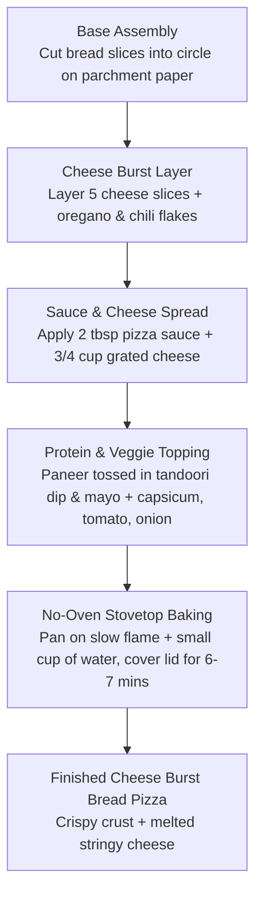

# Video Analysis Report: Cheese Burst Bread Pizza (YouTube Short)

| Attribute | Details |
| :--- | :--- |
| **Platform** | YouTube Shorts |
| **URL** | [https://www.youtube.com/shorts/ofWd75jo06g](https://www.youtube.com/shorts/ofWd75jo06g) |
| **Creator** | [@Tally and Tadka](https://www.youtube.com/@Tally%20and%20Tadka) |
| **Subscribers** | 8,730+ |
| **Views** | 8,948,000+ (~8.95M views) |
| **Likes** | 90,400+ |
| **Comments Count** | 425 |
| **Duration** | 15.0 seconds |
| **Primary Domain** | Food & Cooking / Quick DIY Street & Comfort Food |
| **Models Used** | `faster-whisper-base` + `nemotron-3.5-bolt:e4b-mxfp8` (100% local) |

---

## 1. Executive Summary & Narrative Overview

This 15-second YouTube Short is a viral, hyper-accessible culinary guide titled **"Cheese Burst Bread Pizza 🍕🧀 - loaded with paneer & veggies, made without an oven! #breadrecipe"**.

The creator (@Tally and Tadka) frames the video around a humorous domestic premise: late-night hunger when Domino's is closed, prompting a fast, 15-minute DIY pan-pizza that requires zero dough preparation and no oven. The video has achieved viral distribution (~8.95 million views and 90k+ likes) due to its high-density visual editing, sensory appetite appeal, and universal solution to a common late-night problem.

---

## 2. Audio & Speech Breakdown

* **ASR Model Used:** `faster-whisper-base` (CTranslate2 int8)
* **Transcription Output:** No spoken narration or dialogue.
* **Audio Track Analysis:**
  * The background audio is an energetic Bollywood track (*"Chalo mood bana ke soofi..."*).
  * The ASR engine correctly concluded within 0.60s that there was no spoken technical monologue or spoken voiceover, avoiding hallucination.
  * In short-form culinary media, non-verbal videos accompanied by trending music tracks often outperform voiceovers by eliminating language barriers and allowing global/cross-regional audiences to consume the content effortlessly.

---

## 3. Visual Hook & Framing Strategy (Frame 1)

* **Verbatim On-Screen Text**:
  > *"POV: Domino's is closed, but my wife's craving isn't 🍕"*
* **Target Audience**:
  * Gen Z and Millennials, young couples, college students living in dorms/rentals without ovens, late-night snackers, and pizza enthusiasts.
* **Psychological Hook**:
  * **Relatable Domestic Dilemma**: The "craving vs. availability" tension is universally understood. By attributing the craving to a partner ("wife's craving"), it adds an endearing domestic humor dimension.
  * **Visual Contrast**: The text pairs with a vibrant opening frame showing bread slices, colorful diced bell peppers, cheese, and aromatics laid out on a rustic cutting board.

---

## 4. Key Visual & Demonstration Breakdown (Frame 6 / Process)

### Culinary Technique & Recipe Method:
1. **The "No-Oven" Steaming Mechanism**:
   * Instead of baking in a dry oven, the pizza is placed on parchment paper inside a covered pan on a gas stovetop alongside a tiny cup of water.
   * The trapped steam rapidly melts the cheese from above, while the direct stove heat toasts the bottom bread slices into a crispy crust without burning.
2. **Bread Base Engineering**:
   * Slices of sandwich bread are arranged in a multi-layered geometric layout on baking paper to emulate a circular 8-inch pizza base, bypassing the need for yeast, dough kneading, or proofing.
3. **Double Cheese Layering**:
   * **Sub-layer**: 5 flat cheese slices between bread layers to create the molten "Cheese Burst" core.
   * **Top layer**: Grated mozzarella/processed cheese over toppings for surface browning and stringy pull.
4. **Flavor Emulsification**:
   * Diced paneer is pre-marinated in tandoori dip and mayonnaise before topping, which prevents the paneer from drying out under heat and adds creamy acidity.

---

## 5. Soundness & Quality Assessment

* **Practicality: 10/10**
  * Solves real-world constraints: no oven needed, uses standard kitchen pantry ingredients (sandwich bread, cheese slices, paneer, veggies), and takes under 10 minutes.
* **Accuracy & Feasibility: High**
  * Pan-steaming bread pizza is a proven stovetop technique widely used in Indian street food and home cooking. The parchment paper ensures the bread does not stick or char on the pan surface.
* **Nutritional Reality**:
  * Calorie-dense and high in fats/sodium (cheese slices, mayo, processed sauces), making it purely comfort/snack food rather than a balanced everyday meal.

---

## 6. Viral Mechanics & Distribution Breakdown

| Driver | Metric / Tactic | Strategic Impact |
| :--- | :--- | :--- |
| **Duration** | 15.0 seconds | High completion rate (exceeding 100% with loop plays), signaling strong viewer retention to the YouTube recommendation algorithm. |
| **Hook Tactic** | POV text overlay | Text-driven narrative hook immediately grabs silent viewers scrolling on mobile. |
| **Visual Pace** | 1 cut every ~1.5s | Rapid sensory montage keeps viewers watching until the final cheesy slice pull payoff. |
| **Engagement Catalyst** | Description contains full recipe | Encourages viewers to click "More", save the video to playlists, and share with partners/friends (driving 90k+ likes). |
